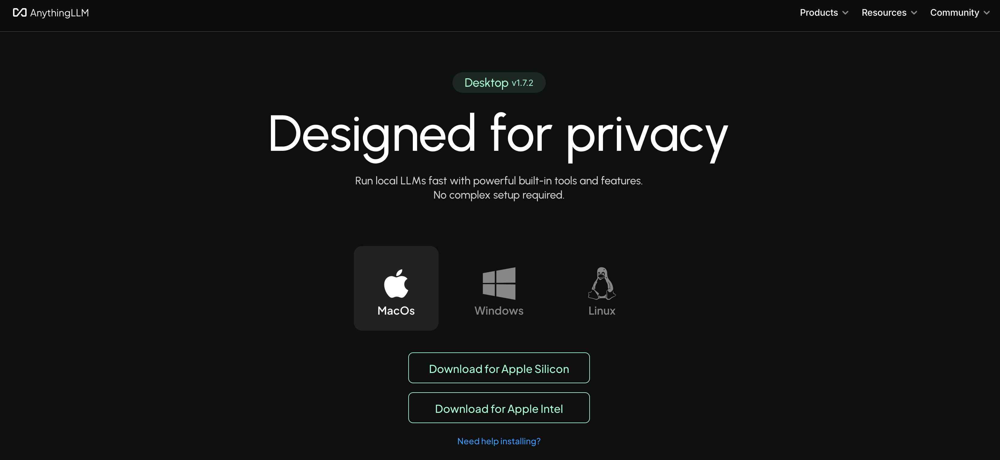
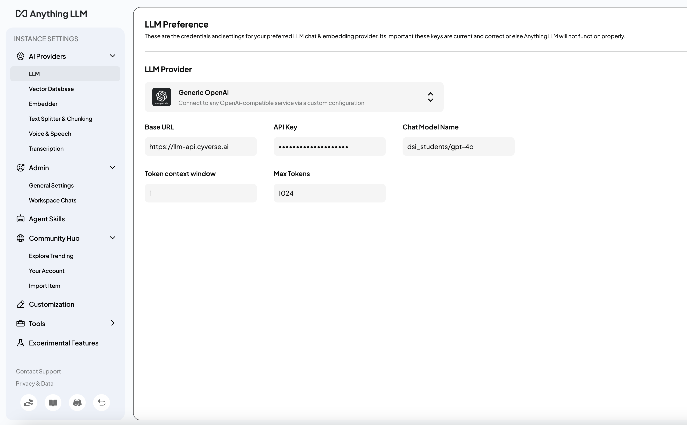
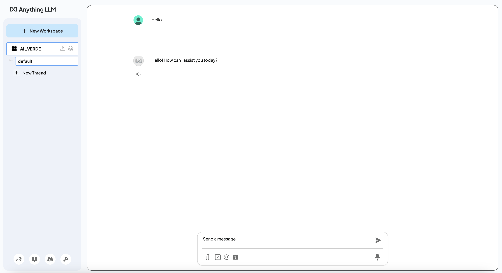
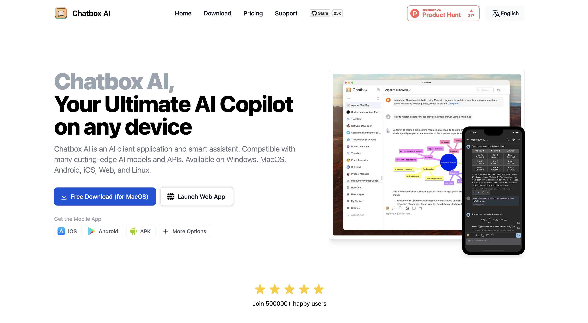
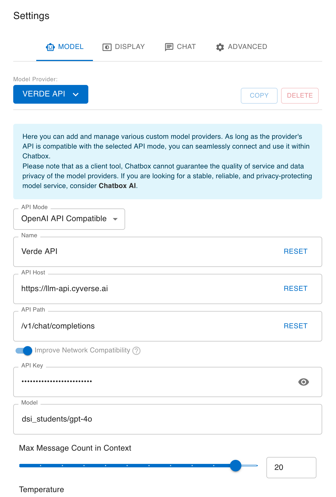
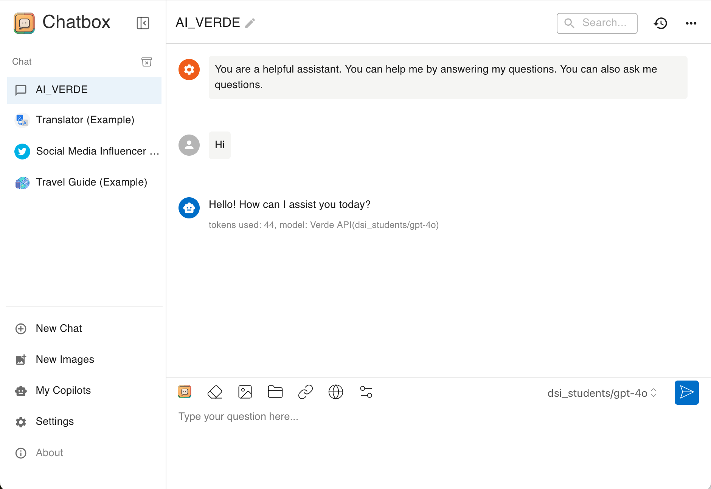

# Examples of using your AI-VERDE API Key in MacOS

Adding AI-Verde to ai platforms takes your chatbot to the next level with smarter, faster AI-powered responses. It handles everyday tasks like customer support, coding help, or data analysis, making your chatbot more versatile. Best of all, AI-Verde's integration works with most chatbot systems!
___
# **AnythingLLM**
## 1. Download AnythingLLM

Download [AnythingLLM](https://anythingllm.com/) into your Desktop and select the version best suited for your device.
 
  {: style="width:80%"}   

Note:     

- Apple Silicon offers faster performance and better energy efficiency compared to Intel processors.    

- Intel processors in Macs offer broad compatibility with older software, better support for running Windows, and more hardware upgrade options.

## 2. Input Provider

1. Open settings on the lower right-hand side.
2. Select AI Provider and LLM.
3. Select Generic OpenAI as the LLM Provider.
4. Add your Base URL, API Key, and Chat Model Name.

  {: style="width:80%"}

## 3. Start Chatting with Verde
  {: style="width:80%"}
___
# **Chatbox**
## 1. Log in to Chatbox

Log in to [Chatbox](https://web.chatboxai.app/) on desktop or launch the web app.

{: style="width:80%"}
## 2. Go into Settings

Input all the elements such as Model Provider, API Key, API Host and Model.

{: style="width:80%"}

## 3. Start Chatting

{: style="width:80%"}
