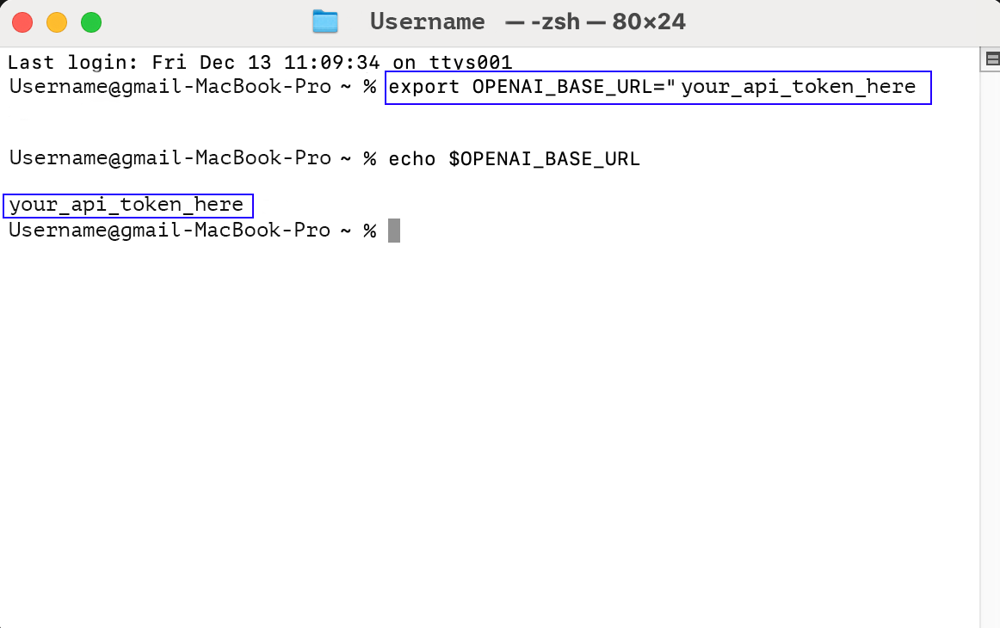

# Step-by-Step Guide: Using an API Key on macOS

This tutorial explains how to store your AI-VERDE API key in environment variables on macOS, so that command-line tools and scripts can use it without you pasting it each time.

Most OpenAI-compatible tools read two environment variables:

- `OPENAI_API_KEY`: your AI-VERDE API key
- `OPENAI_BASE_URL`: the AI-VERDE API base URL, `https://llm-api.cyverse.ai/v1`

See [Obtaining your AI-VERDE API Key](api-key.md) if you do not have your key yet.

## Step 1: Open Terminal

1. Launch the Terminal application on your Mac:
    - Use `Command + Space` to open Spotlight.
    - Type `Terminal` and press `Enter`.

    {: style="width:50%"}

## Step 2: Determine Your Shell

Check which shell you’re using by running:

```bash
echo $SHELL
```

- If the output is `/bin/zsh` (the default on macOS), your configuration file is `~/.zshrc`.
- If the output is `/bin/bash`, your configuration file is `~/.bash_profile`.

## Step 3: Add the Variables to Your Shell Profile

1. Open your configuration file in a text editor:

    ```bash
    nano ~/.zshrc
    ```

    (For bash, use `nano ~/.bash_profile` instead.)

2. Add the following lines at the end of the file, replacing `your_api_key_here` with your AI-VERDE API key. Keep the quotes, and do not put spaces around the `=`.

    ```bash
    export OPENAI_API_KEY="your_api_key_here"
    export OPENAI_BASE_URL="https://llm-api.cyverse.ai/v1"
    ```

3. Save and exit: press `Ctrl + O` to save, `Enter` to confirm, then `Ctrl + X` to exit `nano`.

4. Apply the changes to your current terminal:

    ```bash
    source ~/.zshrc
    ```

    (For bash, use `source ~/.bash_profile` instead.) New terminal windows will pick up the variables automatically.

## Step 4: Verify the Variables

Confirm the variables are set:

```bash
echo $OPENAI_BASE_URL
echo $OPENAI_API_KEY
```

The terminal should display the base URL and your API key.

## Step 5: Test the Key with a cURL Request

List the models available to your API key:

```bash
curl -s "$OPENAI_BASE_URL/models" -H "Authorization: Bearer $OPENAI_API_KEY"
```

A JSON response containing a `"data"` list of models means your key works. See [Getting a List of Models](api-key-models.md) for ways to format the output.

## Step 6: Secure Your Key

1. Avoid hardcoding keys in scripts; read them from environment variables instead.
2. Use `.env` files with tools like dotenv for larger projects, and do not commit them to version control.
3. If your key is compromised, contact your instructor or team lead to have it regenerated.

## Troubleshooting

- **Variable is empty**: Make sure you ran `source` on the correct configuration file, or open a new terminal window.
- **Variable is empty in a new terminal**: Check that you edited the configuration file for your shell (Step 2).
- **`401` or authentication error from curl**: Check that the key was copied completely and that there are no extra spaces inside the quotes.
- **Permission denied**: Check the file permissions of your shell profile.

You're all set! You can now use your API key securely on macOS.
