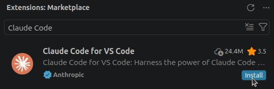
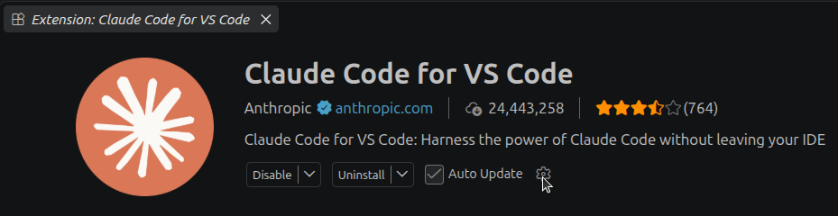
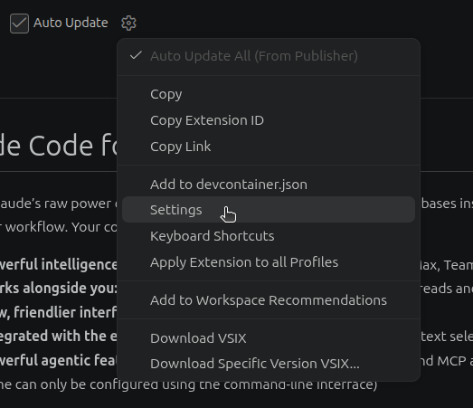
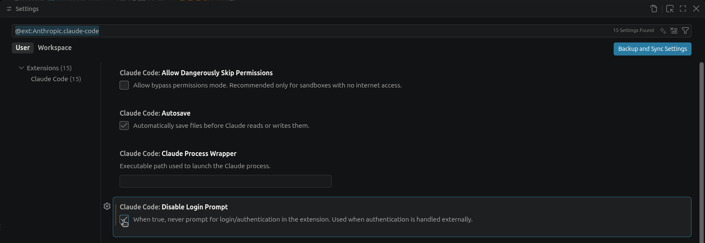
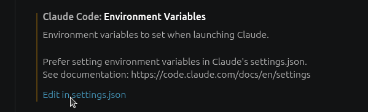
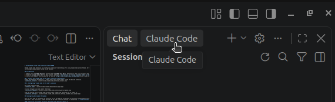
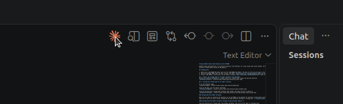

# Using Claude Code for VS Code with AI-VERDE

Claude Code for VS Code is Anthropic's official extension for using Claude Code within VS Code. AI-VERDE can serve as the backend for the extension through AI-VERDE's Anthropic-style API, routing requests through AI-VERDE's budget controls and guardrails.

!!! Tip

    If your course or team's Claude models are hosted on AWS Bedrock, we recommend the [Bedrock-style setup](aws_bedrock_vscode_claude_code.md) instead. Ask your instructor or team lead if you're unsure where your models are hosted.

## Prerequisites

1. Your AI-VERDE course or team must be configured to use Anthropic models (see instructor or team lead).
2. Obtain your AI-VERDE API key. [Instructions can be found here](api-key.md).
3. Note the model names for the Opus, Sonnet, and Haiku models available to your course or team. [Instructions for listing available models can be found here](api-key-models.md). Model names in AI-VERDE are prefixed with an identifier for your course or team, separated by a dash or a slash (e.g. `my-team-claude-sonnet-5` or `my-team/claude-sonnet-5`). Anthropic's public model IDs (e.g. `claude-sonnet-5`) will not work.
4. Install **VS Code**. Instructions can be found at [https://code.visualstudio.com/download](https://code.visualstudio.com/download).

## 1. Install the "Claude Code for VS Code" extension from Anthropic

Within the extension marketplace, a simple search for "Claude Code" yields the desired extension.



## 2. Configuring "Claude Code for VS Code" extension

Go to the extension page.



Click on the gear icon and select "Settings".



Find the setting entry "Claude Code: Disable Login Prompt" and check the box to enable it.



### Configuring Environment Variables

Next you will need to configure the extension to use AI-VERDE as the backend. Set these in the extension's own "Claude Code: Environment Variables" setting. The extension checks this setting before launching, so it is the reliable place for your AI-VERDE credentials; values in `~/.claude/settings.json` do not reach the extension's login check.

Find the setting entry "Claude Code: Environment Variables" and click on "Edit in settings.json".



You will need to add the following environment variables to the `claudeCode.environmentVariables` section of the settings:

- add the AI-VERDE Anthropic base URL as ANTHROPIC_BASE_URL
- add your AI-VERDE API key as ANTHROPIC_API_KEY
- add your team model names for Opus, Sonnet, and Haiku

```json
    "claudeCode.environmentVariables": [
        { "name": "ANTHROPIC_BASE_URL", "value": "https://llm-api.cyverse.ai"},
        { "name": "ANTHROPIC_API_KEY", "value": "<your-ai-verde-api-key>"},
        { "name": "ANTHROPIC_DEFAULT_OPUS_MODEL", "value": "<model name for opus>"},
        { "name": "ANTHROPIC_DEFAULT_SONNET_MODEL", "value": "<model name for sonnet>"},
        { "name": "ANTHROPIC_DEFAULT_HAIKU_MODEL", "value": "<model name for haiku>"}
    ],
```

For example, with the values filled in:

```json
    "claudeCode.environmentVariables": [
        { "name": "ANTHROPIC_BASE_URL", "value": "https://llm-api.cyverse.ai"},
        { "name": "ANTHROPIC_API_KEY", "value": "sk-xxxxxxxxxxxxxxxxxxxxxx"},
        { "name": "ANTHROPIC_DEFAULT_OPUS_MODEL", "value": "my-team-claude-opus-5"},
        { "name": "ANTHROPIC_DEFAULT_SONNET_MODEL", "value": "my-team-claude-sonnet-5"},
        { "name": "ANTHROPIC_DEFAULT_HAIKU_MODEL", "value": "my-team-claude-haiku-4-5"}
    ],
```

!!! Warning

    This setting holds your API key. Add it to your VS Code user settings, not to a project's `.vscode/settings.json`, so the key doesn't get committed with your code.

!!! Note

    To obtain the AI-VERDE Anthropic base URL, simply remove `/v1` (e.g. `https://llm-api.cyverse.ai/v1` => `https://llm-api.cyverse.ai`).

!!! Note

    This setting only applies to the VS Code extension. To use Claude Code in the terminal as well, configure it separately as described in [Claude Code (using Anthropic Models)](api-key-claude.md).

## 3. Restart VS Code

You may need to restart VS Code for the environment variables & settings to take effect.

## 4. Using the extension

The extension has chat functionality accessed from the leftmost bar in VS Code:



You can also open a chat window by clicking on the Claude logo:


