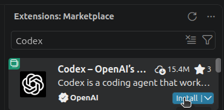
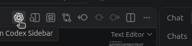
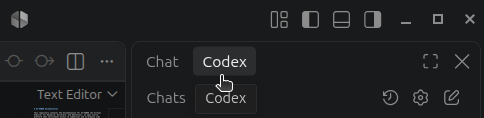

# Using Codex for VS Code with AI-VERDE

Codex is OpenAI's official extension for using Codex within VS Code. The extension reads the same configuration as the Codex CLI, so once Codex is set up to use AI-VERDE on your machine, the extension uses AI-VERDE too.

## Prerequisites

1. Obtain your AI-VERDE API key. [Instructions can be found here](api-key.md).
2. Note the model name you want to use. [Instructions for listing available models can be found here](api-key-models.md). Coding agents work best with models that support tool use; see the "Supports Tools" column in [Current CyVerse Models](../models-current.md).
3. Install **VS Code**. Instructions can be found at [https://code.visualstudio.com/download](https://code.visualstudio.com/download).

## 1. Configure Codex to use AI-VERDE

Follow step 1 of the [Codex guide](api-key-codex.md#1-set-up-the-codex-configuration-file) to add the `ai-verde` provider and your model to `~/.codex/config.toml` (`%USERPROFILE%\.codex\config.toml` on Windows). The extension reads this file. You don't need to install the Codex CLI itself for the extension to work.

### Save your API key in `~/.codex/.env`

The extension has no setting for environment variables, and it doesn't load your shell profile when VS Code starts from a desktop launcher. A `VERDE_API_KEY` exported in `~/.bashrc` or `~/.zshrc` may never reach it. Save the key in `~/.codex/.env` (`%USERPROFILE%\.codex\.env` on Windows) instead. Codex loads this file on startup.

```bash
VERDE_API_KEY=<your-ai-verde-api-key>
```

For example, with the value filled in:

```bash
VERDE_API_KEY=sk-xxxxxxxxxxxxxxxxxxxxxx
```

!!! Warning

    This file holds your API key. Don't commit or share it.

!!! Note

    The Codex CLI reads the same `~/.codex/.env` file, so this also sets up `codex` in the terminal.

## 2. Install the "Codex" extension from OpenAI

Within the extension marketplace, search for "Codex" and install "Codex – OpenAI's coding agent" published by OpenAI.



## 3. Restart VS Code

Restart VS Code so the extension picks up your configuration and API key. If you change `~/.codex/config.toml` or `~/.codex/.env` later, restart VS Code again.

## 4. Using the extension

Open the Codex sidebar by clicking the Codex icon in the editor title bar:



You can also select the "Codex" tab in the chat panel:


