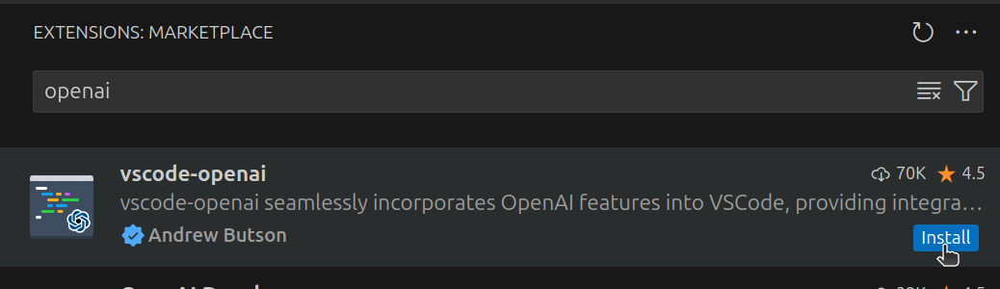
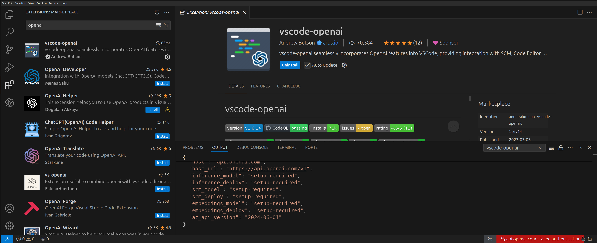
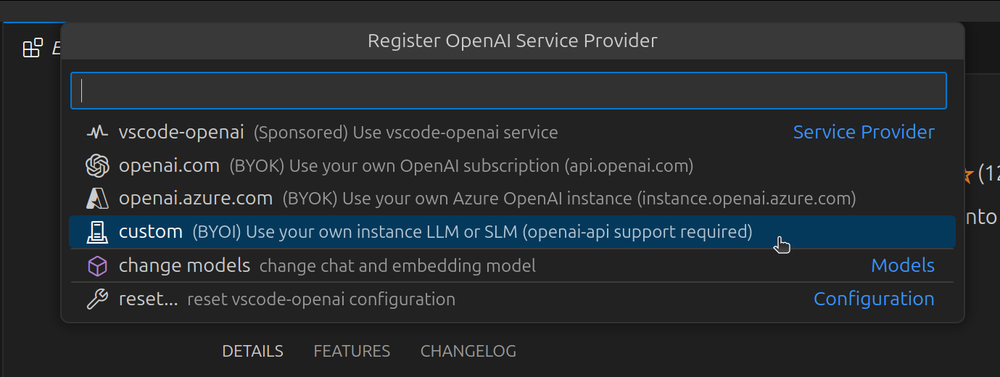
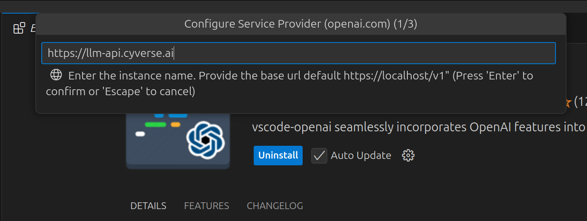
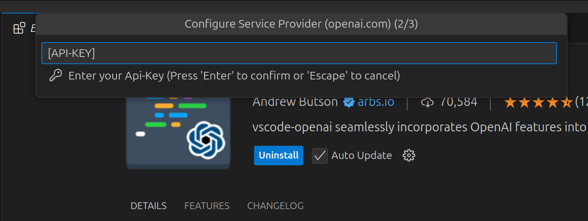
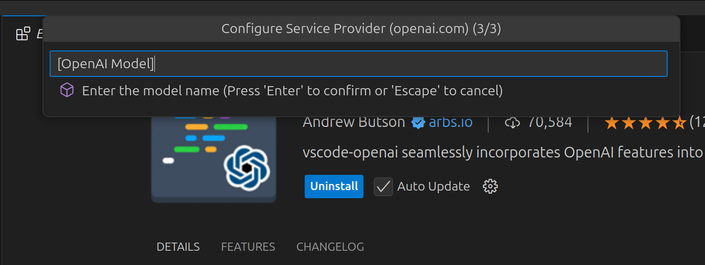
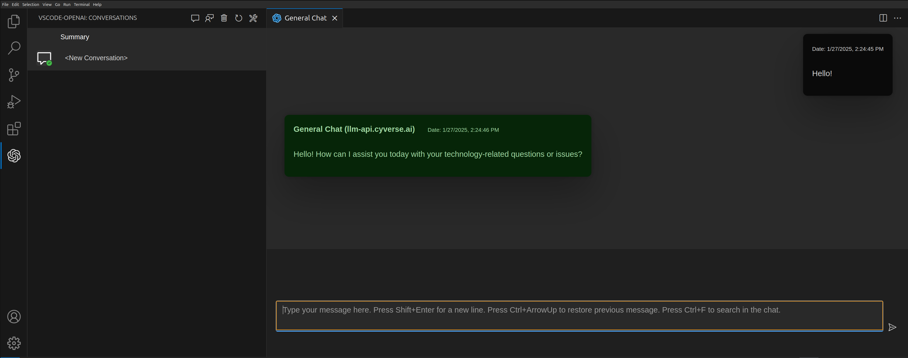
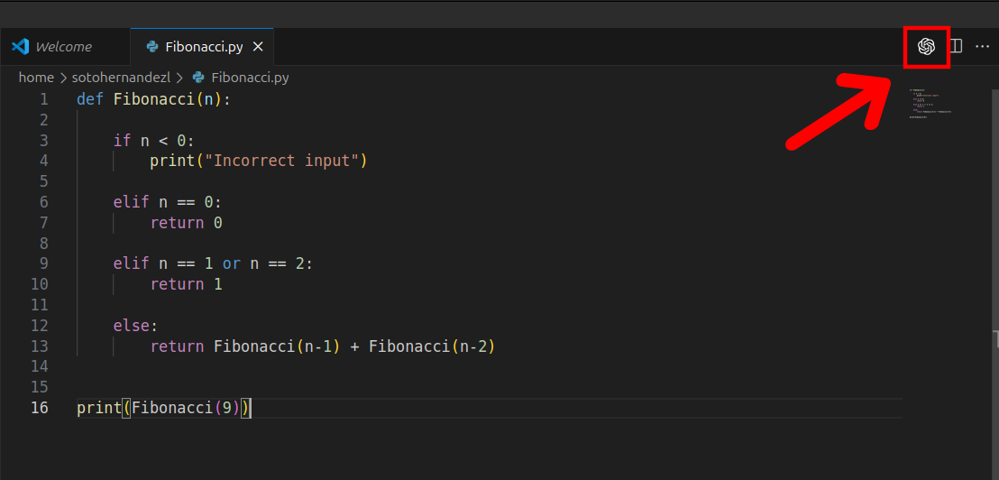

# Using the vscode-openai Extension with AI-VERDE

The vscode-openai extension adds an AI chat panel and code assistance to VS Code. It works with any OpenAI-compatible API, including AI-VERDE.

## Prerequisites

1. Obtain your AI-VERDE API key. [Instructions can be found here](api-key.md).
2. Note the model name you want to use. [Instructions for listing available models can be found here](api-key-models.md).
3. Install **VS Code**. Instructions can be found at [https://code.visualstudio.com/download](https://code.visualstudio.com/download).

## 1. Install the "vscode-openai" extension

Within the extension marketplace, a simple search for OpenAI yields the desired extension.

## 2. Configure the extension

Once installed, a red bar with a "failed authentication" error will appear:

Selecting this red bar will bring out a new menu. In case you need to access this menu again, pressing the bar again will bring it up.

In the new menu, select "custom" from the dropdown list.

The menu will then prompt for an API URL, API key, and model name. Enter these values:

| Prompt     | Value                                                           |
| ---------- | --------------------------------------------------------------- |
| API URL    | `https://llm-api.cyverse.ai/v1`                                 |
| API key    | your AI-VERDE API key                                           |
| Model name | a model name from your model list (e.g. `gemma-4-26b-it`)       |

!!! Warning

    The model name must exactly match a name in your [model list](api-key-models.md).

## 3. Using the extension

The extension has chat functionality accessed from the leftmost bar in VS Code:

The extension also provides insights to your code directly via the OpenAI logo:

