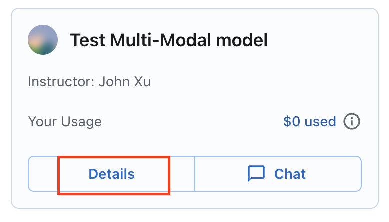
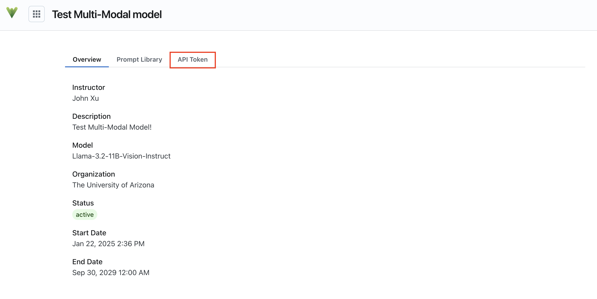
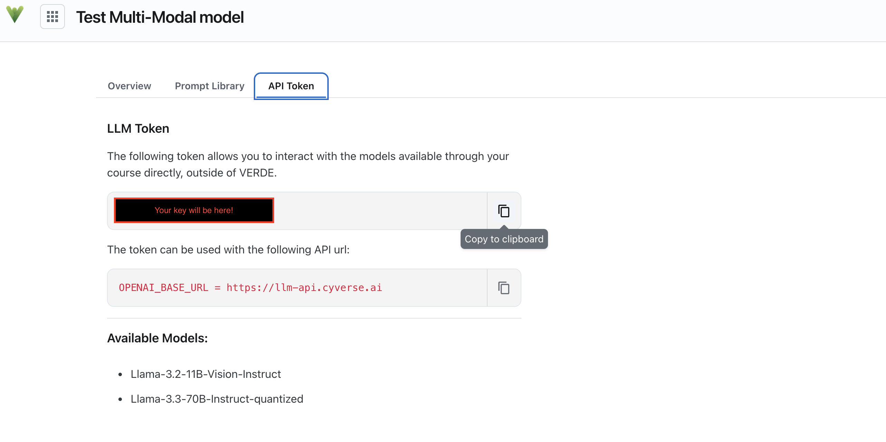

# Obtaining your AI-VERDE API Key

## 1. Sign In

1. Go to [https://chat.cyverse.ai/](https://chat.cyverse.ai/){target=\_new}.
2. Click **Sign In**. You will be taken to CILogon.
3. On CILogon, select your identity provider (for University of Arizona users, **The University of Arizona**) and click **Log On**.
4. Log in with your institution’s login process (for University of Arizona users, your NetID).

## 2. Select Your Team or Course

Click the "Details" button:

{: style="width:75%"}

## 3. Click the "API Key" tab:

{: style="width:75%"}

## 4. Copy and save your API key

{: style="width:75%"}

The models available for your course are listed in the "Available Models" section of the API Key page.
