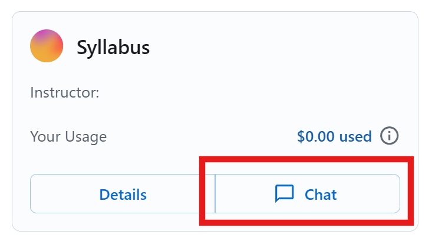
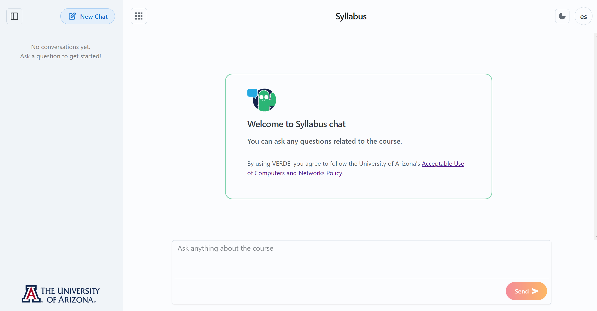
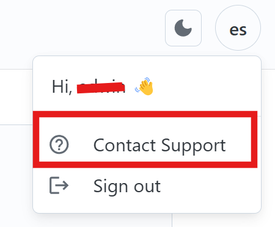

# Getting Started with AI-VERDE Chat

This guide will help you get up and running quickly, so you can start making the most out of your experience with our AI-VERDE Chat.

## 1. Sign In

Before using the AI-VERDE chat interface, ensure you are signed in with your institution's credentials.

!!! Note
    AI-VERDE is currently only available to the University of Arizona community.

1. Go to [https://chat.cyverse.ai/](https://chat.cyverse.ai/){target=_blank}.
2. Click the **Sign In** button. You will be taken to CILogon.
3. On CILogon, select your identity provider. For University of Arizona users, select **The University of Arizona**.
4. Click the **Log On** button.
5. Log in with your institution’s login process (for University of Arizona users, your NetID).
6. You will be returned to AI-VERDE, signed in.

## 2. Select Your Team or Course

Once signed in, find your course or team card and click on the chat button.

{: style="width:50%"}

## 3. Ask Your First Question

After clicking on the course or team card, the page will show a text box where you can interact with AI-VERDE. You can then:

- **Type a question** directly in the chat box (e.g., "Why is the sky blue?").
- **Press Send** to submit.
- **Receive a Response** within seconds, tailored to your query.

{: style="width:100%"}

## 4. Continue the Conversation

You can ask follow-up questions for further clarification, request examples, or explore related topics.

### Example

1. **Initial Question**: "Explain the concept of ecosystems in biology."
2. **Follow-Up**: "Can you provide examples of different types of ecosystems?"
3. **Further Detail**: "How does biodiversity impact ecosystem stability?"

---

## Tips for Using the Chat Interface

- **Be Specific**: Detailed questions yield the best responses.
- **Explore Broadly**: If your team or course is not targeting specific documents, you can ask about a wide range of topics or request explanations for academic concepts.
- **Engage in Multi-Step Conversations**: If you need deeper insights, use follow-up questions to refine the responses.

## Usage Budgets

Each course or team has a usage budget, and some courses also set a budget for each student. By default, budgets are monthly and reset on the 1st of each month. Some courses use a different reset schedule. If you reach your budget, you can use AI-VERDE again once it resets. Ask your instructor or team lead if you're unsure which schedule applies.

## Support and Feedback

If you encounter issues or have suggestions, reach out to our support team using the built-in support chat:

{: style="width:50%"}
